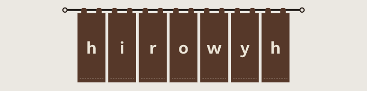
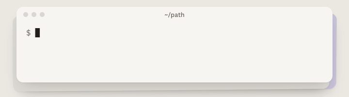
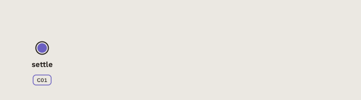
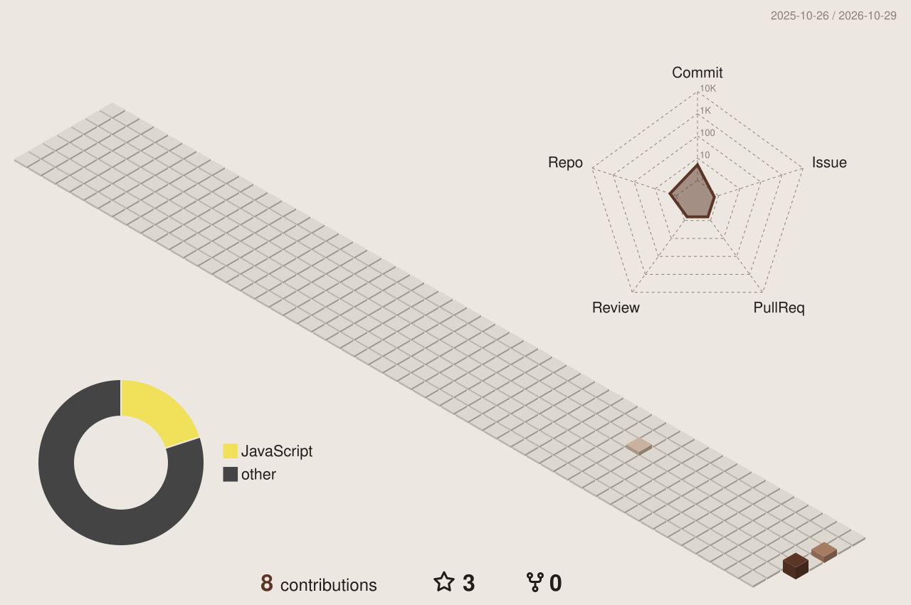
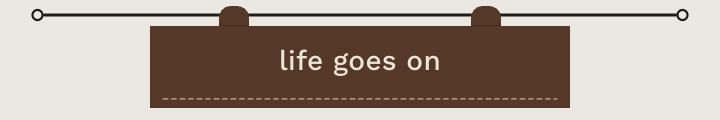

<picture>
  <source media="(prefers-reduced-motion: reduce) and (prefers-color-scheme: dark)" srcset="media/banner-still-dark.png">
  <source media="(prefers-reduced-motion: reduce)" srcset="media/banner-still-light.png">
  <source media="(prefers-color-scheme: dark)" srcset="media/banner-github-dark.gif">
  
</picture>

Hi, I'm Yorihiro (よりひろ). I run community operations for AI-native products at a tech company: I find early users, talk with them, and bring what they say back to the team.

I'm not a designer, and I wanted what I build to move as if a designer had made it. So with Claude I made [settle](https://github.com/hirowyh/settle), my first project: describe a button, a chart or a card in plain words, and your coding agent builds it with motion that settles.

    npx skills@latest add hirowyh/settle

<picture>
  <source media="(prefers-reduced-motion: reduce) and (prefers-color-scheme: dark)" srcset="media/log-still-dark.png">
  <source media="(prefers-reduced-motion: reduce)" srcset="media/log-still-light.png">
  <source media="(prefers-color-scheme: dark)" srcset="media/log-dark.gif">
  
</picture>

Next, I want to help open-source projects that already exist, and build more with Claude. If your project needs someone who talks with users or tries things the way a beginner would, write to me.

<picture>
  <source media="(prefers-reduced-motion: reduce) and (prefers-color-scheme: dark)" srcset="media/route-still-dark.png">
  <source media="(prefers-reduced-motion: reduce)" srcset="media/route-still-light.png">
  <source media="(prefers-color-scheme: dark)" srcset="media/route-dark.gif">
  
</picture>

Before settle, I built websites and small apps with these:

<b>Languages</b> 

<b>Web and data</b> 

<b>Apps</b> 

<b>Tools</b> 

<picture>
  <source media="(prefers-reduced-motion: reduce) and (prefers-color-scheme: dark)" srcset="profile-3d-contrib/profile-noren-dark-still.svg">
  <source media="(prefers-reduced-motion: reduce)" srcset="profile-3d-contrib/profile-noren-light-still.svg">
  <source media="(prefers-color-scheme: dark)" srcset="profile-3d-contrib/profile-noren-dark.svg">
  
</picture>

<picture>
  <source media="(prefers-color-scheme: dark)" srcset="https://raw.githubusercontent.com/hirowyh/hirowyh/output/snake-dark.svg">
  
</picture>

My contributions, redrawn each day: mostly empty for now, and the road ahead is long.

<picture>
  <source media="(prefers-reduced-motion: reduce) and (prefers-color-scheme: dark)" srcset="media/footer-still-dark.png">
  <source media="(prefers-reduced-motion: reduce)" srcset="media/footer-still-light.png">
  <source media="(prefers-color-scheme: dark)" srcset="media/footer-dark.gif">
  
</picture>

The banner, the log, the route map and this footer were each made by settle from a single prompt.

